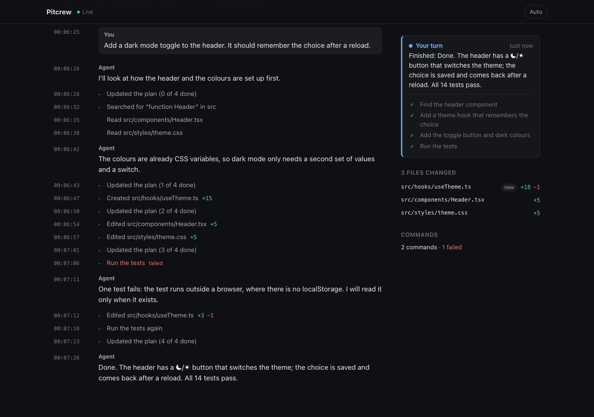

# Pitcrew

**A pit wall for your coding agents.** See every Claude Code session on your machine, live, on one quiet page: what each agent is doing right now, what it changed, which command failed, and which one is waiting for you. Then talk to it from the same page: send a message, answer its permission questions with Allow or Deny, or stop it.

Local only. No account, no cloud, nothing sent anywhere.


## Try it

Pitcrew needs Node.js 20 or newer.

```sh
git clone https://github.com/helloupendra/pitcrew.git && cd pitcrew
npm install
npm run build
npm run demo      # made-up sessions, one of them playing live
npm start         # your own Claude Code sessions
```

It prints a link with a key in it and opens it in your browser. (On npm soon as `npx pitcrew`.)

## What you see

**The pit wall.** How many agents are working, waiting for you, or done and waiting for your reply. Each live session as a card with its plan progress and lines changed, most urgent first. Every project with its branch, uncommitted files and the last seven days of activity. On the right, a feed of what every agent did, across all projects.

**A session.** The whole run in plain words: your messages, the agent's replies, each file it read, each edit with its diff, each command with its output. The plan the agent is following and what it is doing right now stay beside the timeline while you scroll. Long sessions open at the latest step and load earlier steps on request, even when the session file is over a gigabyte.



**Talk.** Write to an agent from the bottom of its session, or press **New session** on a project to start one. Pitcrew runs your own Claude Code (`claude -p`), so your login, settings and allowed tools apply as usual. Whenever Claude Code would ask for permission, the question comes to the page with the command or the diff, and nothing happens until you press **Allow** or **Deny**. A session that is busy in a terminal or in your editor is left alone: reply there.

It works on a phone screen too, in light and dark.

## What the statuses mean

| Status | When |
|---|---|
| **Working** | The agent wrote to the session in the last few seconds, or a tool it started is still running. |
| **Waiting** | The agent asked you a question, or a tool call has had no answer for 45 seconds. Session files do not record an open permission prompt, so Pitcrew says "a long task, or your OK in the terminal" instead of pretending to know which. |
| **Your turn** | The agent finished its reply, or you stopped it. |
| **Idle** | Nothing for 30 minutes. |

## Private by design

- Listens on `127.0.0.1` only, so other machines on your network cannot reach it.
- Every API call needs the key from the link printed in your terminal, so another web page in your browser cannot read your sessions.
- Answers only to the host names `127.0.0.1` and `localhost`, which blocks DNS-rebinding tricks.
- It never writes to your session files; Claude Code does, as always.
- Anything that changes something (a message, Allow/Deny, Stop) needs the key in a request header and a JSON body, which a form on another site cannot send. Start with `--read-only` to turn Talk off completely.
- Nothing is approved for you. Permission questions go to the page through a tiny local bridge (an MCP server Claude Code starts) with its own key.
- No telemetry, no analytics, no fonts or scripts from the internet. The page has a strict Content Security Policy.

## How it works

Claude Code writes each session to `~/.claude/projects/<project>/<session>.jsonl`, one JSON object per line. Pitcrew:

1. Lists those files and reads only the first and last part of each one to name and place the session.
2. When you open a session, it reads the latest 8 MB, turns the lines into steps (a tool call and its result become one step), and follows the file as the agent writes.
3. Checks recently active files every second and the rest every five seconds, and tells the page what changed over a server-sent event stream.

Bookkeeping lines (request logs, file snapshots, account details) are skipped without being parsed.

When you send a message, Pitcrew starts `claude -p` with streaming JSON in and out, in the session's own folder: `--resume <id>` to continue a session, or `--session-id <new id>` for a new one. It stays open for your next message and closes after 15 quiet minutes. Claude Code writes the session file as usual, so the timeline updates the same way as for any other session.

```
pitcrew [--demo] [--port 4747] [--dir <sessions folder>] [--read-only] [--claude <path>] [--no-open]
```

`--dir` defaults to `~/.claude/projects`, or `$CLAUDE_CONFIG_DIR/projects` when that is set.

## What comes next

- **The crew:** specialist agents (QA, code review, security, tests) you start on a project with one click and watch work.
- **The pit lane:** an optional view where each live agent sits in its own pit box and you can see at a glance who is working, waiting or done.
- **More agents:** Codex and other coding agents, next to Claude Code.

## Develop

```sh
npm test            # parser, diff, status, file reading, server security
npm run typecheck
npm run dev:web     # page with hot reload; run `node dist/cli.js --no-open` alongside it
```

Sample data lives in `src/demo` and `test/fixtures` and is made up. Never commit real session files: they hold your prompts and your code.

## License

MIT

Pitcrew is an independent project. It is not made, endorsed or supported by Anthropic. Claude Code is a product of Anthropic.
