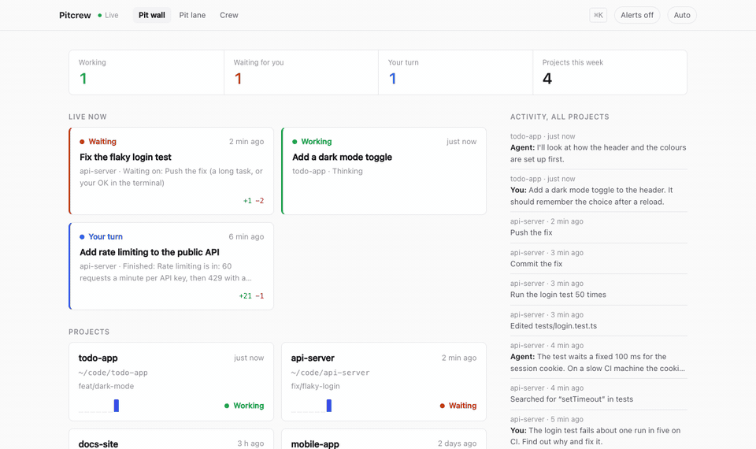
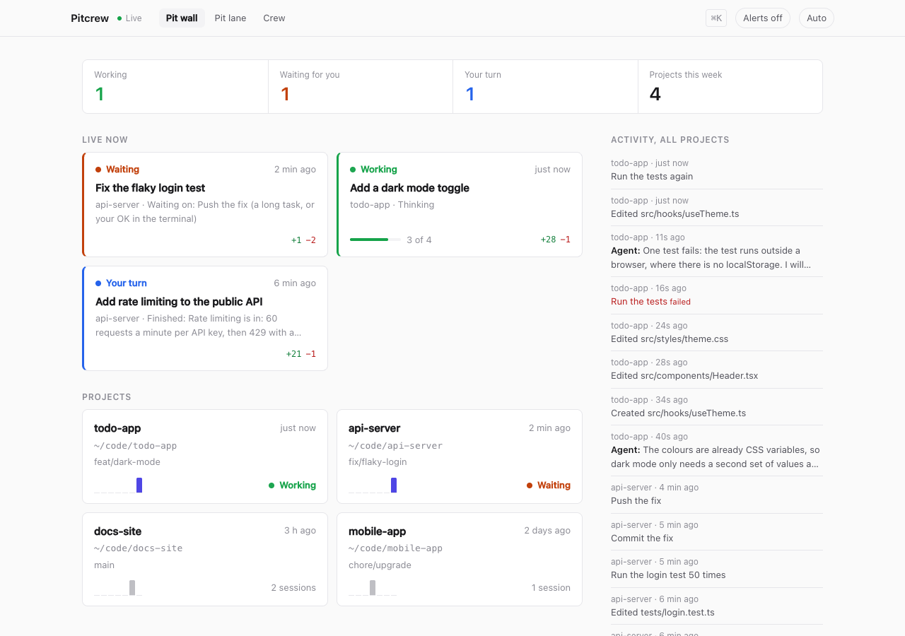

# Pitcrew

**Your pit crew of coding agents, and the pit wall to watch them.** See every Claude Code session on your machine, live, on one quiet page: what each agent is doing right now, what it changed, which command failed, and which one is waiting for you. Talk to it from the same page, answer its permission questions with Allow or Deny, and send in the crew (QA, review, security, tests) with one click.

Local only. No account, no cloud, nothing sent anywhere.



## Try it

Pitcrew needs Node.js 20 or newer, and Claude Code for the parts that talk to agents.

```sh
npx pitcrew-cli --demo     # made-up sessions, one of them playing live
npx pitcrew-cli            # your own Claude Code sessions
```

It prints a link with a key in it and opens it in your browser. To keep it around: `npm install -g pitcrew-cli`, then run `pitcrew`.

From source:

```sh
git clone https://github.com/helloupendra/pitcrew.git && cd pitcrew
npm install && npm run build
npm run demo      # or: npm start
```

## The pit wall

How many agents are working, waiting for you, or done and waiting for your reply. Each live session as a card with its plan progress and lines changed, most urgent first. Every project with its branch, uncommitted files and the last seven days of activity. On the right, a feed of what every agent did, across all projects.



## A session

The whole run in plain words: your messages, the agent's replies, each file it read, each edit with its diff, each command with its output, and the screenshots it took. What it is doing now, its plan, the files it changed and what it cost so far stay beside the timeline while you scroll. A session file of a gigabyte still opens in a fraction of a second.


## Talk

Write to an agent from the bottom of its session, or press **New session** on a project. Pitcrew runs your own Claude Code, so your login, settings and allowed tools apply as usual. Whenever Claude Code would ask for permission, the question comes to the page with the command or the diff, and nothing happens until you press **Allow** or **Deny**.

A session that is open in a terminal or in your editor is never continued in place: reply there, or continue in a copy.

## The crew

Six specialist agents, as ordinary Claude Code agent files: **QA tester**, **Code reviewer**, **Security auditor**, **Test writer**, **Docs writer** and **Dependency doctor**. Run one on any project from the Crew page or with one click on a project, or put them in Claude Code and use them from your terminal:

```sh
npx pitcrew-cli crew install     # then /qa /review /security /tests /docs /deps in Claude Code
```

Make your own from the Crew page. More in [docs/crew.md](docs/crew.md).

## Also

- **Pit lane**: each live agent in its own pit box; moving crew means working, an amber light means it waits for you.
- **⌘K**: go to any project or session, or run the crew, from the keyboard.
- **Alerts**: a desktop notification when an agent starts waiting for you.
- Works on a phone screen, in light and dark.

## Private by design

It listens on `127.0.0.1` only, every call needs the key from your terminal, anything that changes something needs that key in a header plus a JSON body, and nothing is approved for you. `--read-only` turns talking off completely. Details in [docs/security.md](docs/security.md).

## Options

```
pitcrew [--demo] [--port 4747] [--dir <sessions folder>] [--read-only] [--claude <path>] [--no-open]
pitcrew crew install [--project <dir>] [--force]
pitcrew crew list
```

`--dir` defaults to `~/.claude/projects`, or `$CLAUDE_CONFIG_DIR/projects` when that is set. How the reading, the statuses and the talking work: [docs/how-it-works.md](docs/how-it-works.md).

## What comes next

- Codex and other coding agents, next to Claude Code.

## Develop

```sh
npm test            # parser, diff, status, file reading, talk, crew, server security
npm run typecheck
npm run dev:web     # page with hot reload; run `node dist/cli.js --no-open` alongside it
```

Sample data lives in `src/demo` and `test/fixtures` and is made up. Never commit real session files: they hold your prompts and your code.

## License

MIT

Pitcrew is an independent project. It is not made, endorsed or supported by Anthropic. Claude Code is a product of Anthropic.
